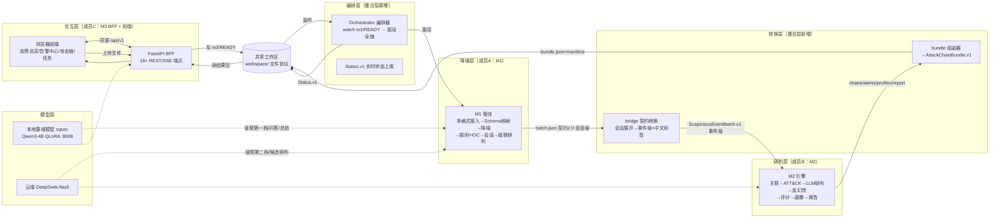
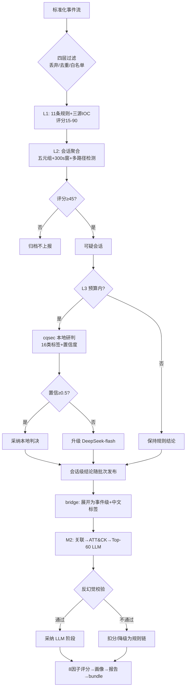

# 文档2：NetGuard 网络安全态势智能感知平台 —— 技术底稿（数据流 / 要点与创新 / 代码实现）

> 本文档是正式技术文档（文档1）的内容底稿，按"主流程与数据流向 → 题目要点与创新点 → 代码级实现"三部分组织。
> 所有样例数据均来自平台真实运行产物；所有代码引用格式为 `文件:行号`（2026-09-22 代码版本）。

---

# 第一部分 主流程与数据流向

## 0. 整体框架与数据流向总览

### 0.1 系统总体架构



**架构原则**：模块间唯一交换方式是"共享工作区 + 版本化数据契约 + 原子文件投递"（无任何内部 RPC），
每个模块可独立运行、独立测试、独立恢复——这与工业级开源 SOC 编排（如 Wazuh-Autopilot 的
Policy Guard 设计）思路一致，同时规避了服务耦合。

### 0.2 数据流总表（一图看懂数据的旅程）

| # | 阶段 | 输入 | 处理 | 输出（契约） | 规模（官方1.1万条实测） |
|---|---|---|---|---|---|
| ① | 上传 | CSV/XLSX/JSON/PCAP 文件 | 魔数校验+SHA-256 | m3/READY 清单 | 11,000 行 / 1.04MB |
| ② | M1 接入与映射 | 原始文件 | 魔数判型→三级Schema映射 | 标准化事件 | 11,000 标准化事件 |
| ③ | M1 降噪 | 标准化事件 | 丢弃/去重/白名单 | 有效事件流 | 10,955 会话 |
| ④ | M1 检测 | 有效事件 | 11条规则+三源IOC+评分 | 可疑会话 | 6,631 可疑会话 |
| ⑤ | M1 级联研判 | Top-N 可疑会话（≤1%） | cqsec先判→低置信升级flash | semantic_judgements | 110/110 本地判决 |
| ⑥ | bridge 转换 | 会话级 batch.json 2.0 | related_event_ids 展开+标签映射 | SuspiciousEventBatch.v1 事件级 | 6,675 事件 |
| ⑦ | M2 关联 | 事件级 parquet | 加权评分+并查集+ATT&CK | 攻击候选 | 6,577 候选 |
| ⑧ | M2 LLM 研判 | Top-60 候选 | DeepSeek-flash+反幻觉校验 | 增强链/规则链 | 60 研判 / 6,577 链 |
| ⑨ | M2 评分画像 | 攻击链 | 8因子评分+画像+要素 | alerts/attackers/report | 889 画像 |
| ⑩ | bundle 组装 | M2 五类 JSON | 引用闭合+M3校验器自校验 | AttackChainBundle.v1 | 前端直接可读 |
| ⑪ | 前端呈现 | bundle | SSE 进度/筛选/链图/问答/调查 | 人机交互 | 全功能 |

---

## 1. 主流程逐段详解：数据原始 → 处理 → 输出

### 1.1 ①→② 多模态接入与 Schema 映射

**输入样例**（官方 xlsx 第 1 行）：
```json
{"timestamp":"2025-11-08 13:28:00","user_agent":"Mozilla/5.0 (Macintosh…)","method":"GET",
 "src_ip":"10.25.73.34","dst_ip":"10.60.33.18","url_path":"/api/orders?sort=name&…",
 "request_body":null,"attack_type(结果列…)":"正常访问"}
```

**做了什么**：
1. **魔数判型**：读文件头 16 字节识别格式（4 种 PCAP 字节序 / PCAPNG / 扩展名回退），不信任扩展名（`m1/run.py:234 detect_format`）；
2. **三级 Schema 映射**：①15 字段中英文别名表精确匹配（confidence=1.0）→ ②类型画像（采样 100-500 行统计列类型，"类型+token"启发式消歧）→ ③仍未识别的字段发**一次** LLM schema 级调用（置信度≥0.85 才采纳），映射方案按表头 SHA-256 冻结缓存、后续全程序转换不再调 AI（`m1/run.py:42 ALIASES / 512 schema_profile / 533 llm_mapping / 554 get_mapping_plan`）；
3. **标准化**：IP 合法性、端口范围、协议大写、ISO 时间、生成 event_id 与不含时间的内容指纹。

**输出样例**（event_details.parquet 一行）：
```json
{"event_id":"bef25322-2a5c-41ea-9a2d-20fd14b9a732","batch_id":"batch-50ff5629…",
 "timestamp":"2025-10-19T12:37:00+00:00","src_ip":"10.25.73.34","dst_ip":"10.60.33.18",
 "url_path":"/api/transfer&test=1&debug=1",
 "request_body":"email%3Dattacker@example.com%26role%3Dadmin&test=1",
 "raw_reference":"{'source_file': 'incoming/50ff5629-sample_alerts.csv', 'row': 1}"}
```

**PCAP 多模态通道**（样例来自 tests_integration/fixtures/sample_traffic.pcap，54 包→3 流）：
```text
普通流：GLYPH flow 10.25.73.34>10.60.33.18 proto=TCP pkts=5 distinct_dst_ports=3
        span=…09:00:00..09:00:28 dst_ports_sample=[80,443,8080]
扫描流：GLYPH flow 45.61.10.9>10.60.33.18 proto=TCP pkts=46 distinct_dst_ports=40
        PORT_SWEEP dst_ports=21,22,23,25,53,80,110,135,139,143,443,445,993,995,1433,…
```
包级元数据按 (源,目的,协议) 聚合为"每流一行"的文本摘要（`m1/run.py:280 pcap_to_glyph_rows`），
与 CSV 告警**走同一条降噪管线**——多模态统一为文本表示（PCAP-LM/PacketGlyph 思路，
arXiv:2607.28100）；同流触达 ≥15 个目的端口即注入 `PORT_SWEEP` 标记，由 `flow_scan` 规则检出端口扫描。

### 1.2 ②→③ 智能降噪

**做了什么**（四层过滤，全部有计数可观测）：
1. 无意义丢弃：无网络身份且无安全内容（`m1/run.py:618 is_meaningless`）；
2. 内容指纹去重：15 字段规范化 SHA-256 + 60 秒时间桶（`m1/run.py:887 dedup_key`，时间不参与指纹）；
3. 白名单/可信网段过滤（`m1/run.py:654`）；
4. SimHash+LSH 近似分组：仅用于复核展示压缩（Jaccard≥0.90），**不删任何事件**。

**输出**：官方 1.1 万条 → 10,955 会话（去重/过滤计数实时可见于前端任务分析面板）。

### 1.3 ③→④ 规则+IOC 检测与会话聚合

**做了什么**：
- **L1 单事件**：11 条正则签名（SQL注入/XSS/目录遍历/文件包含/命令注入/CSRF/Java反序列化/文件上传/扫描器/提示注入/端口扫描），匹配前做最多 2 轮 HTML 实体+URL 解码与 Base64 附加解码（`decode_security_text m1/run.py:665`）；风险分基线 15-90（`RISK 表 m1/run.py:71`）。
- **L1.5 第二层传统机器学习 LightGBM（m1-ml-1.0）**：官方 11,000 行按请求指纹分组切分（60/20/20，防近重复行跨集泄漏），52 个结构化特征（方法/路径/载荷/UA/网段/时间），会话聚合前批量推理；白名单类别取"模型分数最高且过校准阈值者"写 `ml_*` 伪规则（分数低于对应确定性规则，**确定性标签优先、ML 次之**），阈值按"precision 预算阶梯 + 融合 FPR≤1%"在校准集选取；冻结测试集（真实管线两臂对照）RCE recall 64.7%→87.4%、macro-F1 88.9→94.8、融合 FPR 0.30%，全量 11,000 行 acc 88.43→95.66%；加载/预测失败 fail-open 降级纯规则并留痕（`m1/ml_features.py`、`m1/ml_detector.py`、`m1/ml_split.py`、`scripts/train_ml_detector.py`、`scripts/eval_ml_detector.py`，证据 `docs/evidence/ml_acceptance_20261114.json`）。
- **IOC 三源**：手工配置 + 本地 SQLite 库（**Spamhaus DROP + OpenPhish 真实情报**，`m1/local_ioc.py:38 update`，72h 过期原子替换）+ 可选微步在线。
- **L2 会话**：五元组分组 + 300 秒不活动窗 + 3600 秒最大时长双切断（`aggregate m1/run.py:724`）；滑动窗多路径扫描检测（`l2.py:54 detect_scans`）；频率/源活跃度/资产关键性加分，总分封顶 100，≥45 判可疑（`apply_contextual_scores m1/run.py:785`）。

**输出样例**（suspicious_events.parquet 一行）：
```json
{"session_id":"8bbdcb06b5f7e6c8cfeb7ec4","rule_hits":["csrf"],
 "evidence":[{"type":"rule","name":"csrf","rule_version":"m1-rules-1.4"}],
 "risk_score":60,"risk_level":"medium",
 "semantic_evidence":{"request_body":"email%3Dattacker@example.com%26role%3Dadmin&test=1"},
 "session_fingerprint":"d00f0101…cc64","semantic_status":"not_selected"}
```

### 1.4 ④→⑤ 级联语义研判（级联路由创新点）

**做了什么**：候选预算 `max(1, min(count//100, count×1%))` 强制上限（`l3_candidates m1/run.py:895`）；
每个候选**先由本地垂域模型 cqsec（Qwen3-4B QLoRA 微调）研判**：16 类标签白名单校验、
"正常访问"→benign 0.85、风险高/中/低→置信 0.9/0.7/0.45；**低于 0.5 或解析失败自动升级云端
DeepSeek-flash**；三级计数 local_hits/escalations/failures 全程可观测（`cascade_local_judge m1/run.py:964`）。

**输出样例**（semantic_judgements.parquet 一行——注意这是本地模型判决的）：
```json
{"session_id":"d80c11e3ed84ad8d7dc3ff27","verdict":"malicious","confidence":0.9,
 "summary":"本地垂域模型判定为Java反序列化漏洞利用攻击；【处置建议】隔离应用主机；升级存在漏洞的反序列化组件…",
 "model":"cqsec-cascade-local","prompt_version":"m1-l3-judge-1.2-cascade",
 "attack_label":"Java反序列化漏洞利用攻击"}
```
**全量实测：110/110 候选全部由本地模型判决，云端调用 0 次**——小模型管"多与快"，
云端管"深与准"（FrugalGPT arXiv:2305.05176、RouteLLM arXiv:2406.18665 的工程化落地；
SIABENCH arXiv:2603.06422 亦支持"初筛用小模型、深度分析用强推理"的分档范式）。

### 1.5 ⑤→⑥ 契约转换（bridge 整合层）

**为什么需要**：M1 产物是**会话级**（1 行=1 会话），且没有 M2 必填的 `event.task_id`/`event.timestamp`
列——直连会被 M2 逐行 pydantic 校验静默丢弃（11000 行→0 事件）。

**做了什么**（`bridge/export_m2_batch.py:80 export_batch`）：
1. 按 `related_event_ids` 把可疑会话**展开回事件级**（保留事件时间戳供 M2 时间衰减关联）；
2. 会话级检测结论（规则/IOC/评分/标签）复制到成员事件，`session_id` 原样传递（M2 同会话关联 +0.10 加分）；
3. **官方中文标签层**：M1 英文规则名→赛题 8 类中文标签的确定性映射（`bridge/labels.py:11`），
   多规则命中按优先级取最具体者（命令注入/反序列化 > 注入类 > 上传/遍历 > XSS/CSRF > 扫描）；
   无规则命中标"待研判"，**绝不使用数据集 ground truth 列**；
4. 投递顺序：清旧标记→parquet→manifest.json（逐文件 sha256）→最后写 READY。

**输出样例**（M2 inbox 事件行）：
```json
{"event_id":"1e728923-ea45-4595-8ca4-6b01ff93e049","task_id":"task_c838dd85…",
 "timestamp":"2025-10-17T13:43:00+00:00","payload_digest":"880573ff…",
 "matched_rules":["xss"],"score":65.0,"reason":"rule:xss; 标签:XSS跨站脚本攻击",
 "attack_type":"XSS跨站脚本攻击","risk_level":"medium","schema_version":"1.0.0"}
```

### 1.6 ⑥→⑧ M2 关联、ATT&CK 映射与 LLM 研判

**做了什么**：
1. **加权关联+并查集**：两两评分（时间 0.30/攻击者 0.25/受害者 0.20/端口 0.10/协议 0.05/行为 0.10，
   共享 IOC +0.15、同会话 +0.10），"不同攻击者且无共享 IOC"一票否决，≥0.55 合并
   （`correlation/engine.py:91 link_decision`）；按攻击者/受害者分块剪枝，近线性复杂度；
2. **ATT&CK 映射**：本地知识库 14 战术/34 技术，关键词/端口/协议信号确定性打分——首遍映射完全可复现，
   LLM 只做候选子集复核（`attack/knowledge.py:240 match_techniques`）；
3. **LLM 候选研判（Top-N 预算）**：按"候选内最高事件分+事件数"排序取 Top-60 送 DeepSeek-flash
   （`response_format: json_object`），其余候选自动走规则链不丢覆盖（`pipeline.py:397`）；
   并发 5、指数退避重试、Pydantic 严格校验，JSON 不合规直接判失败降级；
4. **反幻觉证据校验**：LLM 引用的 evidence_event_ids 必须真实存在、技术必须在候选集内、
   实体必须有证据支撑；每项问题扣 0.05、确认幻觉再扣 0.25、上限 0.9；全阶段无效则整链退回规则结论
   （`attack/evidence_validator.py:38`）。设计同 RHINO（arXiv:2510.14233，"抽象化→多角色推理→对照官方
   ATT&CK 校验"三段式抗幻觉）与 DeepFaith（arXiv:2607.24348，证据锚定把报告忠实度 0.68→0.92）。

**输出样例**（chains.json 一条 7 阶段链，节选）：
```json
{"chain_id":"chain_…","stages":[
   {"stage_index":1,"tactic":"TA0001","technique":"T1133","tactic_name":"Initial Access","source":"rule"},
   {"stage_index":2,"tactic":"TA0002","technique":"T1203","source":"llm"}, …共7阶段],
 "risk_score":{"score":51.93,"factors":[{"name":"tactic_severity","weight":0.22,"value":0.4,"contribution":0.088},…共8因子],
   "rationale":["highest-impact tactic: TA0010 (Exfiltration)","4 distinct ATT&CK tactics observed"]},
 "evidence_validation":{"valid":true,"hallucination_detected":false,"issues":[{"code":"insufficient_evidence",…}]}}
```

### 1.7 ⑧→⑨ 评分、画像与报告

**做了什么**：
- **8 因子风险评分**：tactic_severity 0.22 / evidence_strength 0.16 / ioc 0.14 / asset_criticality 0.12 /
  rule_score 0.12 / llm_confidence 0.08 / chain_length 0.08 / multi_stage 0.08（`risk/scorer.py:59`），
  每个因子带权重/取值/贡献/依据——**可解释**；置信度独立计算且 LLM 自报值不直接采信
  （`risk/confidence.py:55`）；
- **攻击者画像**：按攻击源聚合链/告警，行为摘要+工具/用户名/IOC 提取；**归因纪律：无证据一律
  "Not Determined"、置信度 0**——不编造组织/国家（`profiling/attacker_profiler.py:175`）；
- **威胁要素**：IP/域名/CVE/哈希/工具等 14 类实体，每个实体必绑定 evidence_event_ids。

### 1.8 ⑨→⑩ bundle 组装（整合层）

**做了什么**（`bundle/assemble.py:159 assemble`）：
1. 把 M2 五类 JSON（chains/alerts/attackers/entities/report）组装为 M3 定义的
   **AttackChainBundle.v1**：引用闭合（所有 evidence 引用 ⊆ 已知事件集）；
2. **写出前用 M3 的 Bundle 校验器自校验**——任一引用不闭合整包拒绝，不投递半成品；
3. **置信度卡片**：合并 8 因子评分 + 反幻觉校验结论 + 惩罚明细为
   `confidence_card`（报告/问答/前端三处共用）；
4. **中文告警标题/描述**（展示层翻译）：基于确定性标签/等级/方向构造——
   `疑似{官方标签}：{攻击源} → {受害资产}`，不虚构结论；
5. 严重度融合：M2 链评分 vs M1 规则初筛**取较高者**（M2 对单事件候选偏保守，M1 规则分是真实信号）；
6. 原子投递：staging→sha256 manifest→rename（含 Windows 拒绝访问 5 次重试）。

**输出样例**（中文告警 + 置信度卡片）：
```json
{"title":"疑似Java反序列化漏洞利用攻击：10.253.83.6 → 10.253.68.168",
 "description":"经规则引擎与模型研判判定为「Java反序列化漏洞利用攻击」，风险等级 严重；关联攻击链 4 个阶段，证据 3 条。…",
 "severity":"critical","attack_type":"Java反序列化漏洞利用攻击"}
{"confidence_card":{"score":51.93,"factors":[…8因子],"penalties":[{"reason":"有效证据不足"}],
 "evidence_validation":{"valid":true,"hallucination_detected":false},
 "summary":"综合风险分 51.93/100；LLM 结论反幻觉校验通过（有效证据 0 条）；共 2 项惩罚/提示"}}
```

### 1.9 ⑩→⑪ 前端呈现与人机交互

**做了什么**（M3 BFF + 前端）：
- **SSE 实时进度**：编排器把 M1 逐千条计数、L3 级联进度（x/y、本地判决数）、M2 十阶段中文进度
  （含"模型研判 k/60"）镜像为 Status.v1；BFF 以 0.25s SSE 推给前端"任务分析"面板逐段流式展示；
- **告警中心**：中文标题/类型/等级/置信度筛选+搜索+分页+已读标记；
- **攻击链 SVG 图**：阶段节点/边/证据引用，点击查看阶段详情与证据；
- **智能问答（混合路由）**：统计类问题（"多少条/占比/最主要类型"）由系统**确定性直答**——数字与
  页面指标卡同源、零幻觉零成本；知识/解释类走本地 cqsec 模型（上下文=精确统计块+≤6 条证据摘要，
  严格控制在其 1024 token 窗口内）；
- **一键自动调查**：SSE 轨迹流式输出"载入→情报富化→逐链调查→反幻觉校验→结论"
  （产品形态对齐 Microsoft Security Copilot Agents 与 Google Security Ops 的 Auto-Investigate）；
- **威胁情报查询**（三层）：本地层（ip2region 离线 GeoIP 境内/境外 + M1 IOC 库命中）→ 在线层
  （ip-api 国家/运营商）→ 信誉层（AbuseIPDB/OTX，有 key 才启用）；
- **PDF 报告**：七节结构化中文报告（执行摘要→指标统计→告警统计→重点攻击链 Top5→画像→处置建议→
  证据附录），页眉页脚页码、等级配色表格。

---

## 2. 二程数据：中间产物作为输入（数据流的"接力"）

| 中间产物 | 生产者 | 作为谁的输入 | 再次发生了什么 |
|---|---|---|---|
| 标准化事件（event_details.parquet） | M1 ② | M1 降噪/检测；bundle 证据索引 | 载荷只写盘一次，分析层仅保留 ≤512 字语义证据——"大负载落盘、轻证据入内存"的压缩设计 |
| 可疑会话（suspicious_events.parquet） | M1 ④ | bridge 展开；L3 研判 | 会话按 related_event_ids 还原为事件级；其检测结论（规则/IOC/评分）下放到每个成员事件 |
| semantic_judgements | M1 ⑤ | M1 结果汇总；评测 | 级联判决（含 attack_label）随批次发布，可反哺训练数据（数据飞轮） |
| M2 inbox 事件（batch_000001.parquet） | bridge ⑥ | M2 关联/研判/去重 | M2 二次去重（event_id+内容指纹）——纵深防御；M1 会话 id 用于同会话关联加分 |
| 攻击链（chains.json） | M2 ⑦⑧ | 评分/画像/要素/bundle/前端链图 | 链的 factors/rationale 组装为 confidence_card；链的 stages 渲染为前端 SVG 与 PDF 攻击链表 |
| 告警（alerts.json） | M2 ⑨ | bundle→前端告警中心 | 中文标题/描述在组装层生成；event_ids 必须闭合于证据集 |
| AttackChainBundle.v1 | bundle ⑩ | M3 BFF/问答/调查/PDF | 唯一前端消费入口；sha256 manifest 保证未被篡改 |

---

# 第二部分 题目要点 × 流程重点 × 创新点

> 每个流程段落的"重点"与"创新点"跟着主流程走；论文/工业界出处全部经过调研核实。

## 2.0 要点覆盖总览

| 赛题要点 | 落点流程 | 状态 | 对应创新点 |
|---|---|---|---|
| 多模态上传（CSV/PCAP 等） | 1.1 | ✅ 6 格式 + PCAP 文本化 | ③ PCAP→Glyph 多模态统一通道 |
| 智能降噪 | 1.2/1.3 | ✅ 四层过滤+SimHash | 预算化 LLM 降噪（≤1%） |
| 风险研判（机器为主） | 1.4/1.6/1.7 | ✅ 规则+级联+关联+反幻觉 | ① 级联路由 ④ 反幻觉证据校验 |
| 人工为辅 | 复核组/置信卡片/PDF | ✅ | ② Grounded Confidence 卡片 |
| 风险事件报告 | 1.8/1.9 | ✅ JSON+PDF 七节 | 证据锚定生成（DeepFaith 路线） |
| 智能问答 | 1.9 | ✅ 混合路由 | 统计确定性直答（数字同源零幻觉） |
| 攻击画像 | 1.7/1.9 | ✅ 889 画像+前端卡片 | 归因纪律（Not Determined） |
| 运营总结 | 1.9 | ✅ cqsec 能力⑤ | 精确统计注入（禁止模型推算） |
| 万级性能 | 全链 | ✅ 1.1万条 6-8 分钟（智能）/2.5 分钟（规则） | Top-N 预算+级联降本 |
| 攻击类型精准研判 | 1.3/1.4 | ✅ 官方 8 类全覆盖 | 中文标签层（确定性映射） |
| 基于开源大模型训练垂域模型 | 模型层 | ✅ cqsec 自建 15340 条语料 | 级联研判头+数据飞轮 |
| 整合威胁情报 | 1.3/情报查询 | ✅ Spamhaus/OpenPhish 真实库 | 三层情报查询（离线优先） |

## 2.1 六大创新点（按主流程顺序，附依据）

**创新点① 小-大模型级联路由（流程 1.4）**
本地垂域模型（Qwen3-4B QLoRA，自建 15340 条语料，16 类分类 macro-F1 97.05%）作为研判第一档，
置信度不足才升级云端 DeepSeek——全量实测 **110/110 候选本地判决、云端 0 次调用**，云端 LLM 成本趋近于零。
依据：FrugalGPT（arXiv:2305.05176）与 RouteLLM（arXiv:2406.18665）证明级联可数量级降本；
SIABENCH（arXiv:2603.06422）确立"初筛小模型、深析强推理"范式；TextReasoningBench（arXiv:2603.19558）
实测长思维链对分类任务 token 膨胀 10-100× 仅换 +1~3%，佐证"分类用小模型、推理用大模型"的分档。

**创新点② 反幻觉证据校验 + 置信度卡片（流程 1.6/1.8）**
LLM 结论的每条证据必须回溯到真实事件、每个技术必须在候选集内，幻觉定量扣分并降级整链；
8 因子评分与反幻觉扣分合并为"证据×权重×置信度"卡片，报告/问答/前端三处共用，**可现场演示**
（喂入噪声证据看扣分）。依据：RHINO（arXiv:2510.14233）三段式 ATT&CK 抗幻觉；DeepFaith
（arXiv:2607.24348）证据锚定生成。**这是全链最强的差异化点**——多数开源 SOC LLM 项目
（如 AI_SOC、SecurityClaw）没有评测与反幻觉体系。

**创新点③ PCAP→Glyph 多模态统一通道（流程 1.1）**
不还原载荷，把包级元数据聚合成"每流一行"的文本摘要进入同一降噪管线，CSV/PCAP 在语义层统一；
端口扫描以 ≥15 目的端口阈值确定检出。依据：PCAP-LM/PacketGlyph（arXiv:2607.28100）2026 年提出的
"流量转 ASCII 语义摘要"最新做法。

**创新点④ 告警提示注入自防（流程 1.3→1.4）**
LogInject（arXiv:2607.14493）指出告警原文进 LLM 前可被投毒。我们做两层防御：①注入模式作为 L1
规则（`prompt_injection`，RISK=50）——"对 AI 接口的注入探测本身就是可疑事件"，进入正常研判管线；
②所有载荷出网给任何 LLM 前经 `sanitize_for_llm` 沙箱化（命中片段替换为 `[注入内容已拦截]` 并计数）。
安全比赛中"防自己的 AI"是稀有空位。

**创新点⑤ 混合路由问答与数字同源（流程 1.9）**
统计类问题由系统直接作答（与页面指标卡同源、零幻觉、零成本、零延迟）；知识类走本地垂域模型，
上下文注入"精确统计块+证据摘要"并明确约束"禁止推算"。解决了 LLM 问答"数字对不上页面"的通病。

**创新点⑥ 契约化三级数据流水线（流程 1.5/1.8）**
M1(会话级契约 2.0)→bridge(事件级契约 1.0.0+官方标签)→M2(五类 JSON)→bundle(AttackChainBundle.v1
自校验)。每个契约版本化、校验和落盘、原子投递；bundle 组装器写出前用消费方校验器**先验自检**——
引用不闭合不出门。这套"生产者自证清白"的契约工程在比赛级项目中罕见。

## 2.2 关键流程图

**降噪-研判主流程（含级联与反幻觉门）**：


**级联成本-覆盖示意**（实测数字）：
```
候选总量 110 ──► 本地 cqsec 判决 110（100%）──► 升级云端 0（0%）
M2 候选 6577 ──► 预算内 LLM 研判 60 ──► 规则链兜底 6517（覆盖率 100%）
```

---

# 第三部分 代码级实现介绍（功能↔代码，与第一/二部分相辅相成）

> 前端每一个特色按钮、每一个功能都有对应实现。引用格式 `文件:行号`。

## 3.1 交互层功能（用户直接看到的）

| 前端功能 | 后端端点 | 核心实现 |
|---|---|---|
| 文件上传（拖拽/6格式） | `POST /api/v1/files`（server.py:128） | 扩展名白名单+2GB 上限+流式 SHA-256；魔数校验 `validate_upload`（m3_services.py:17，XLSX 解压规模/压缩比防炸弹） |
| 新建分析任务 | `POST /api/v1/tasks`（server.py:217） | 写 m3/READY 文件协议投递（不 RPC），编排器 3s 监听认领（driver.py:397 watch） |
| **任务分析实时面板** | `GET /tasks/{id}/stream`（SSE 0.25s） | 编排器镜像实时计数：M1 主循环每 1000 条写运行状态（m1/run.py:1180）、L3 进度线程每 2s 写"模型研判 x/y+本地判决数"（m1/run.py:1027）、M2 十阶段中文翻译（driver.py:114 M2_STAGE_ZH，"模型研判 k/60"）；前端流式日志保留最近 14 条（m3-ext.js:67 pushLog，近 4 条去重） |
| **指标 chips + 数据总量** | 任务列表（slim） | 前端跨任务聚合：告警总数/高危链/校验状态/**接入原始数据条数**/降噪后可疑条数（m3-ext.js:158 renderStatChips）；hero 行同步总量 |
| 告警中心（中文） | `GET /tasks`（slim） | 中文标题在 bundle 组装层生成（assemble.py:98 _zh_title_and_desc）；等级/时间/置信度/关键字四维筛选+分页（m3-ui.js renderAlerts） |
| **告警详情（点击秒开）** | `GET /tasks/{id}/alert/{alert_id}`（server.py:260） | KB 级轻量响应（单告警+关联链切片+证据切片+建议），替代整包 40MB 拉取；弹窗先显示"加载中…"加载态（m3-ext.js:206） |
| 攻击链 SVG 图 | 任务详情 | 阶段节点+边渲染+缩放（m3-ui.js renderChain），点击节点显示阶段详情与关联证据 |
| **⚡ 一键自动调查** | `POST /tasks/{id}/investigate`（server.py:619） | SSE 轨迹：载入→情报富化→Top5 逐链调查（含 confidence_card）→反幻觉校验→结论；前端逐帧渲染轨迹（m3-ext.js runInvestigate） |
| **🛡 置信度卡片** | bundle.chains[].confidence_card | 8 因子条形图+惩罚项+反幻觉结论前端渲染（m3-ext.js:328 renderCard） |
| **🔍 威胁情报查询** | `GET /intel/lookup`（server.py） | 三层：本地层 ip2region **自实现 xdb 二分读取器**（intel_lookup.py:44，11MB 离线库）+M1 IOC SQLite；在线层 ip-api；信誉层可选。攻击类型命中本地知识库 attack_intro.json（16 类简介/特征/检测/处置） |
| 智能问答 | `POST /chat`（SSE） | 混合路由：统计类正则命中→系统直答（m3_services.py:146-159）；知识类→cqsec 能力④（intel_qa），上下文=统计块+证据摘要 ≤1024 token；引用强制 ⊆ 检索集 |
| **导出 PDF 报告** | `GET /reports/{id}?format=pdf` | 七节结构（server.py:394 _build_pdf_report）：执行摘要→指标表→统计表→攻击链 Top5 表→画像→处置建议→证据附录；工程点：CJK 字体族映射（registerFontFamily 防 `<b>` 报错）、动态文本 XML 转义（载荷含真实 `` 攻击串）、页脚页码 |
| **↺ 重置演示** | `POST /admin/reset`（server.py:675） | 有任务运行 409 拒绝；全屏遮罩+旋转动画期间阻断操作（m3-ext.js resetDemo） |
| 导出 JSON | `GET /reports/{id}` | 完整任务快照附件 |

## 3.2 降噪层核心实现（M1）

| 能力 | 实现 |
|---|---|
| 多格式接入 | `detect_format`（m1/run.py:234）魔数判型；PCAP 纯 struct 解析器（:368 parse_pcap/:386 parse_pcapng/:409 parse_ethernet_packet），不还原载荷 |
| Schema 三级映射 | 别名表（:42）→类型画像（:512，采样统计+启发式消歧）→LLM 兜底（:533，单次调用+置信度门+SHA-256 冻结缓存） |
| 去重与白名单 | 内容指纹 15 字段 SHA-256+时间桶（:887）；白名单 IP/网段（:654）；四类过滤计数可观测 |
| 规则与 IOC | 11 条签名（:59-70）+解码增强（:665）；IOC 三源（:694-700 本地库 local_ioc.py:76 Spamhaus/OpenPhish 72h 原子替换） |
| CSRF 规则 1.4 | 原规则保留+`CSRF_BODY_MARKER`（:72）攻击者载荷特征（去空白匹配容忍 +/%3d 混淆），方法门控 POST/PUT/PATCH/DELETE（:687）；官方 942 条 CSRF 覆盖 934、正常流量 0 误报 |
| 提示注入自防 | 8 类注入模式（:934）→ 规则化检出（:945，RISK=50）+出网前沙箱化 `sanitize_for_llm`（:949，计数 injection_blocked） |
| 会话聚合 | 五元组+双窗切断（:724/:715）、行为检测 multi_path_scan（l2.py:54 差分数组线性标记）、评分组件可解释（:785） |
| 级联研判 | 预算 `max(1, min(N//100, N×1%))`（:895）；cqsec 先判+白名单回配（:964）；并发池+连续失败熔断（:1018-1087） |
| 实时进度 | 主循环每 1000 条写状态（:1180，含 total_hint 预估）；L3 进度线程（:1027）；与 M3 状态镜像联动（driver.py:173） |
| 原子发布 | staging→行数核对→READY.json（batch_sha256）→read_batch 自校验→rename（:1137-1292）；消费侧校验 handoff.py:29（防路径逃逸 :44） |

## 3.3 转换层与研判层核心实现（bridge + M2）

| 能力 | 实现 |
|---|---|
| 契约转换 | 会话展开（export_m2_batch.py:114）、字段映射 21 列（:29）、payload_digest/raw_ref 补全（:44/:62）、READY 最后写（:217） |
| 官方标签层 | RULE_LABELS/PRIORITY（labels.py:11/:26）——确定性映射、不用 ground truth、无命中标"待研判" |
| 加权关联 | 权重表（config.yaml:98-104）+一票否决（engine.py:101-110）+分块剪枝（:159-189）+并查集（:249） |
| ATT&CK 知识库 | attack_kb.yaml 14 战术/34 技术，确定性首遍映射（knowledge.py:240） |
| LLM 研判+预算 | Top-N 排序（pipeline.py:397-410）+Semaphore 并发（invoker.py:134）+指数退避（:281）+Pydantic 严格校验（base.py:120-127） |
| 反幻觉校验 | 五步校验（evidence_validator.py:114-336）、扣分公式 0.05×问题+0.25×幻觉（:75-81）、整链降级（:100-104） |
| 攻击链构建 | LLM 阶段优先/规则兜底（chain_builder.py:154/:196）、战术序排序 ≤12 阶段（:291-331）、单证据阶段合并不虚构（:268） |
| 8 因子评分 | scorer.py:59（权重表 config.yaml:158-166，每因子带依据）；置信度独立计算（confidence.py:55，LLM 权重降级时归一化剔除 :113） |
| 画像与要素 | attacker_profiler.py:74（行为摘要）+归因纪律（:175 Not Determined）；extractor.py:69（实体必绑证据） |
| 原子投递+幂等 | tmp+sha256+rename+DONE（bundle_writer.py:98-354）；processed registry 输入 checksum 幂等重放（registry.py:137）；租约认领崩溃可接管（claim.py:38） |
| bundle 组装 | 引用闭合（assemble.py:209/:297/:331）+M3 校验器自校验（:484）+严重度融合（:35）+Windows rename 重试（:508）+置信度卡片（:259）+中文标题（:98） |

## 3.4 模型层与编排层

| 能力 | 实现 |
|---|---|
| 本地垂域模型五大能力 | llm/cqsec.py:65 chat（单 user 消息/温度 0.1/≤4 并发/UA 约束）+ judge/event_report/attacker_profile/intel_qa/ops_summary（:105-169）；训练格式对齐 fmt_alert（:92 七字段定长） |
| 全链编排 | driver.py:277 process_task（前置情报导出→投递输入→M1→bridge→M2→bundle）；run_file 测试入口（:411）；幂等标记（:374） |
| 实时状态镜像 | Popen 管道双线程排空防死锁（driver.py:132-150）+每 2s 轮询翻译（:173）；M1 指数爬升进度/L3 换算/M2 阶段中文+llm k/n |
| 降级开关 | DEEPSEEK_ENABLED=0 → M1 LLM 关闭+M2 LLM_PROVIDER=disabled，纯规则全链仍产出（driver.py:236/:453） |
| 状态上报容错 | write_status 6 次短重试（driver.py:96-104），最终失败仅记日志——状态上报失败绝不让任务失败 |
| 性能工程（M3） | 列表 slim_bundle/public_task（6577 链任务从 70MB→KB 级）、_raw_bundle 对象缓存跳过重复脱敏（server.py:177-180）、GZip 中间件、STATE_LOCK 防并发竞态（:38/:168） |

## 3.5 测试与工程质量

- **测试规模**：M1 56 项 + M2 约 201 例（unit/contract/integration/performance 四层）+ 整合层 16 项；
  修复故事：运行时真实情报曾覆盖测试期望的种子数据 → conftest 固定 `THREAT_INTEL_PATH=data/threat_intel_seed`
  隔离（backend/module2_chain/tests/conftest.py:51-57），"任何测试都不触 DeepSeek API"。
- **Windows 并发工程三修复**（可作为工程能力叙述）：status.json 读锁互斥重试（driver.py:96-104）、
  bundle os.replace 杀毒占用重试（assemble.py:508-517）、SSE/子进程管道排空防死锁（driver.py:132-150）。
- **跨平台数据**：四种真实格式横切用例（tests_integration/fixtures/：CSV/XLSX/PCAP/注入 CSV）。
- **可复现性**：所有 ID 确定性派生（sha256），同输入多次运行结果一致（M2 集成测试验证）。

---

# 附：性能与规模实测汇总（写作素材）

| 场景 | 数据量 | 耗时 | 说明 |
|---|---|---|---|
| 智能模式全链（级联+flash） | 11,000 条 | 6m36s ~ 8m22s | 级联 110/110 本地判决 0 云调用；M2 Top-60 flash |
| 极速模式（纯规则+本地） | 11,000 条 | 2m28s | DEEPSEEK_ENABLED=0 |
| 380 行样本全链 | 380 条 | ~30s（规则）/ ~5 分钟（智能） | 演示推荐 |
| PCAP 多模态全链 | 54 包→3 流 | ~12 秒 | 端口扫描检出 T1595 |
| M1 单机吞吐 | 100,000 行 CSV | 10.5 秒 | 基准测试 |
| M2 关联吞吐 | 10,000 事件 | ~4 秒（2500 ev/s） | 单任务上限 200 万事件 |
| 情报查询 | 单 IP | <1 秒（离线层） | 全离线不出网 |
| PDF 报告 | 6577 告警 | 0.3 秒 | 5 页 15KB |
